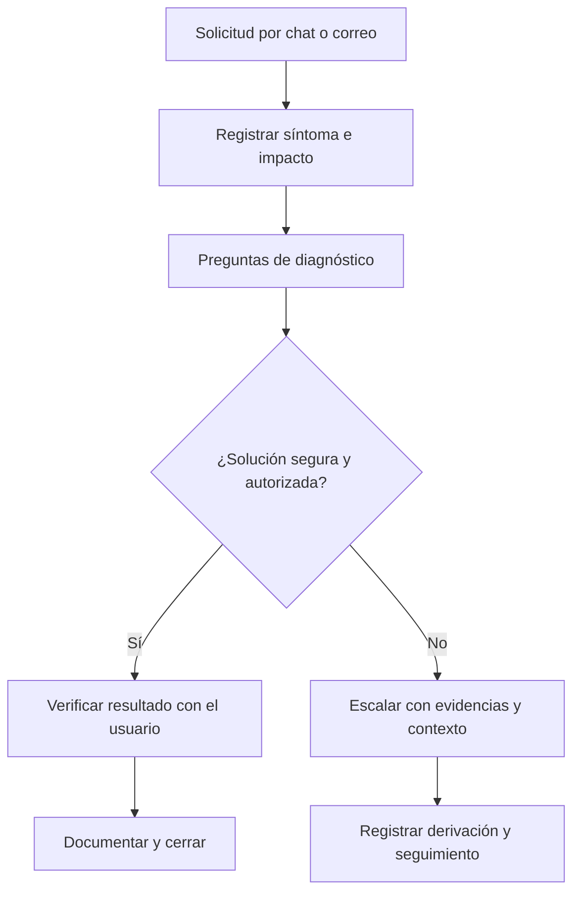

# 🎫 Simulador de tickets | Help Desk N1

**Portafolio práctico de aprendizaje · Atención por chat y correo · Nivel inicial**

  

> **Propósito:** demostrar cómo se recibe, clasifica, documenta y deriva una solicitud de soporte, con comunicación profesional y trazabilidad. Los escenarios son ficticios y no constituyen experiencia laboral ni procedimientos internos de una empresa.

## 🧭 Navegación
| Sección | Contenido |
|---|---|
| [Caso TICKET-001](casos/TICKET-001-acceso-aplicacion.md) | Problema de acceso a una aplicación corporativa |
| [Guía de práctica](PRACTICA.md) | Cómo realizar y evaluar una simulación completa |
| [Diagnóstico técnico](https://github.com/mujeresglobalesgestion-ops/help-desk-n1-diagnostico-tecnico) | Proyecto independiente con pruebas de Windows y conectividad |

## 🔄 Flujo de atención

## 🧪 Casos
| ID | Escenario | Documentación | Simulación interactiva |
|---|---|---|---|
| [TICKET-001](casos/TICKET-001-acceso-aplicacion.md) | Acceso a aplicación | Preparada | Pendiente |
| TICKET-002 | Segundo caso por definir | Pendiente | Pendiente |

## 🎯 Competencias demostrables
Comunicación escrita · preguntas de diagnóstico · registro ITSM básico · manejo de prioridades · seguridad de datos · criterios de escalamiento.

## 📌 Estado y criterios de cierre
**En desarrollo.** Se cerrará este proyecto cuando se hayan realizado y documentado al menos dos simulaciones completas, con evaluación y decisión de cierre o escalamiento. **No se han validado resoluciones técnicas reales.**

## 🔐 Buenas prácticas
No solicitar ni publicar contraseñas, códigos MFA o datos personales. No inventar SLA, accesos ni resultados. Este repositorio es un proyecto educativo independiente, sin afiliación a ninguna empresa.
